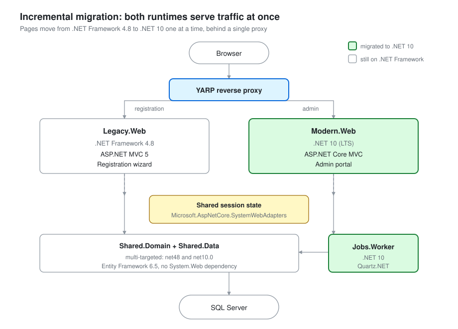

# aspnet-mvc5-to-net10-migration

Migrating a legacy ASP.NET MVC 5 app to .NET 10 incrementally, with both
versions running behind a proxy while pages move across one at a time.



## Background

.NET 8 went out of support on 10 November 2026. Plenty of production
systems are still on it, or still on .NET Framework, and most are too
large to rewrite. "Rewrite it in .NET Core" isn't something a business
can act on while the app is making money every day.

The alternative is a strangler-fig migration: old and new run at the same
time, and functionality moves across piece by piece. This repo works
through one.

## Scope

- Shared libraries multi-targeted to `net48` and `net10.0`, so both apps
  run the same business logic during the transition
- `System.Web` dependencies pulled out of business logic behind interfaces
- YARP plus `Microsoft.AspNetCore.SystemWebAdapters` for shared session
  state across the two runtimes
- Background jobs moved to a Worker Service first, as the lowest-risk step
- Characterization tests written before any code changed
- EF6 kept through the migration, with one bounded context moved to
  EF Core afterwards

## The sample app

ConfReg, a conference registration system. Four-step public registration
wizard, admin portal, three background jobs. Small, but it has the things
that make real migrations painful: state held in Session, a 30-minute
payment hold, seat capacity rules, and config spread through the codebase.

## Known problems in the baseline

The legacy app is built with the defects these codebases actually have:

| Problem | Where |
|---|---|
| `HttpContext.Current` inside business logic | `Shared.Domain` |
| Whole EF entities stored in Session | Registration wizard |
| `ConfigurationManager` reads scattered throughout | Everywhere |
| Secrets in plain text in Web.config | `Legacy.Web/Web.config` |
| No `[Authorize]`; login check in `_Layout.cshtml` | Admin portal |
| Reversible password encryption | `AdminUser` |
| Connections opened and never closed | `Shared.Data` |
| No tests | Whole solution |

Several more turned up during the build rather than being planned, including
an auth check that only runs when a Razor layout renders, and a race on the
last available seat. Those are listed separately in
[docs/01-baseline.md](docs/01-baseline.md).

## Phases

| Phase | What | Docs |
|---|---|---|
| 1 | Baseline legacy application | [01-baseline](docs/01-baseline.md) |
| 2 | Characterization tests | [02-tests](docs/02-tests.md) |
| 3 | Multi-target the libraries, remove System.Web | [03-libraries](docs/03-libraries.md) |
| 4 | Background jobs to a Worker Service | [04-jobs](docs/04-jobs.md) |
| 5 | Strangler-fig migration of the web tier | [05-strangler](docs/05-strangler.md) |
| 6 | Benchmarks | [06-results](docs/06-results.md) |
| 7 | EF6 to EF Core, one context | [07-efcore](docs/07-efcore.md) |

## Results

Benchmarks go here after Phase 6: requests/sec, p95 latency, memory and
cold start, legacy against modern on the same dataset.

## Running locally

```bash
cp .env.example .env && docker compose up -d     # SQL Server
cp config/secrets.config.example src/Legacy.Web/secrets.config
dotnet user-secrets set "ConfReg:ConnectionString" "..." --project src/Jobs.Worker   # or ConfReg__ConnectionString
# Legacy.Web needs Windows + IIS Express, or tools/linux/host-legacy.sh (Mono) to try it elsewhere
dotnet run --project src/Modern.Web              # arrives in Phase 5
```

`Legacy.Web` targets net48 and needs Windows with IIS Express. CI runs the
legacy and characterization jobs on `windows-latest` and everything else on
`ubuntu-latest`. Full setup in [docs/00-setup.md](docs/00-setup.md).

## Trade-offs

EF6 kept through the migration. IIS on Windows rather than containers.
Front end left alone. Reasoning for each in
[docs/08-tradeoffs.md](docs/08-tradeoffs.md).
